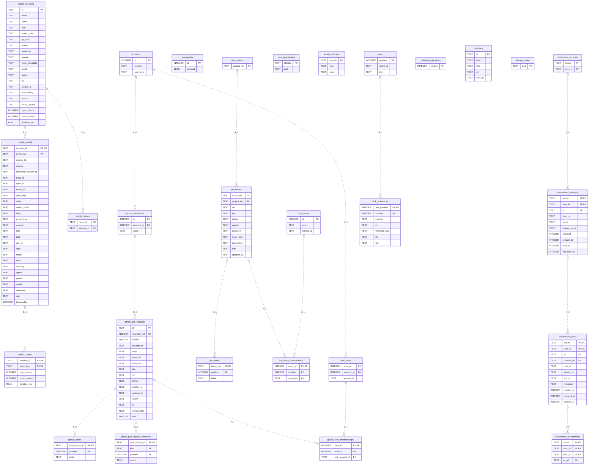

# Database schema

Generated by `npm run db:docs` from all SQLite migrations. Do not edit.

The SQL file includes tables, views, explicit indexes and triggers. SQLite's internal objects and migration data are excluded.

Relationships show declared foreign keys conservatively (zero or one parent, zero or many children); uniqueness and requiredness are defined in [schema.sql](schema.sql). Encoded identifiers use `encoded_` followed by the UTF-8 name in hexadecimal. Views appear only in the SQL schema.
